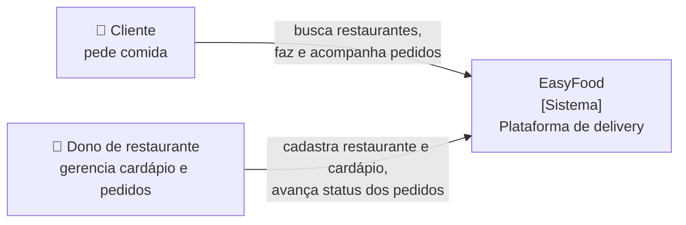
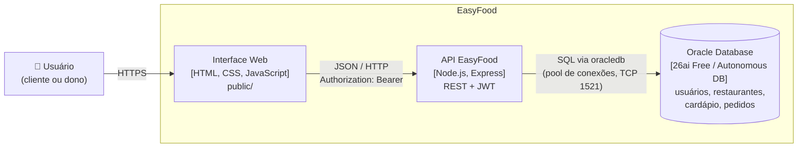
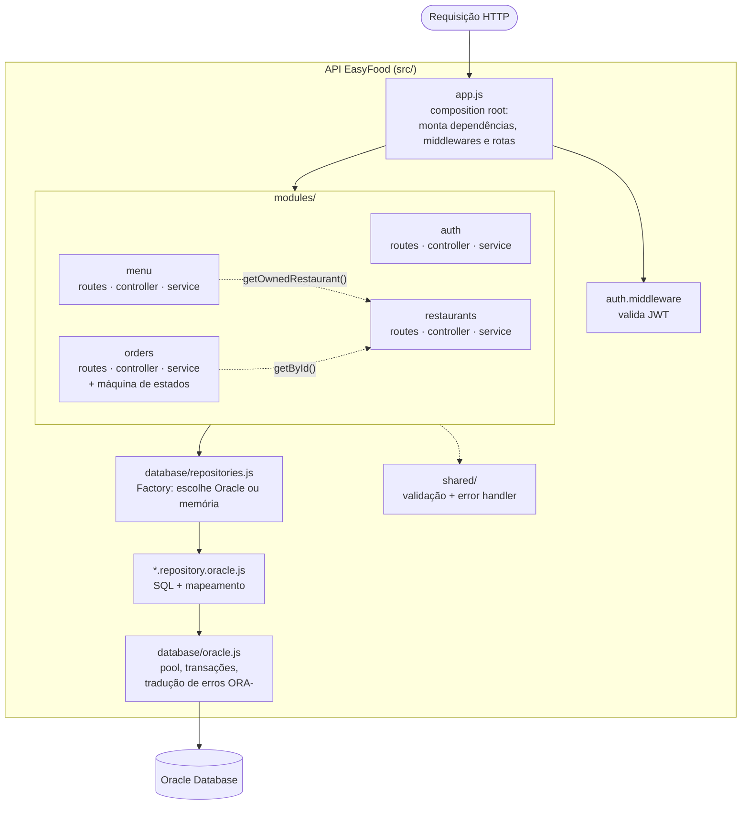
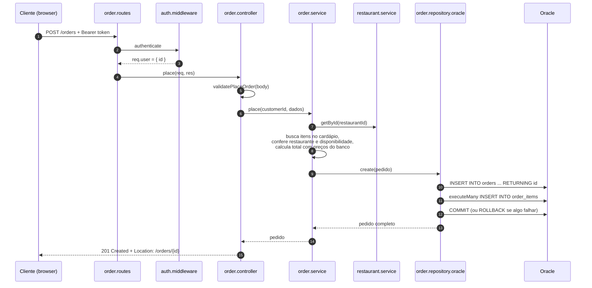
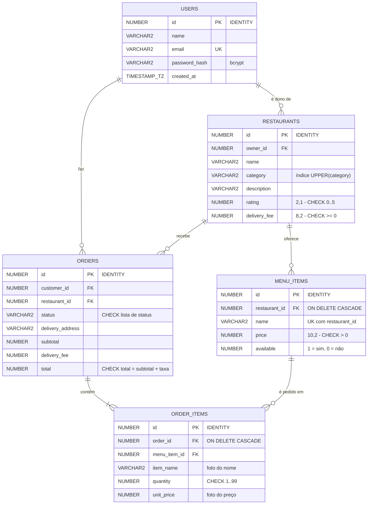
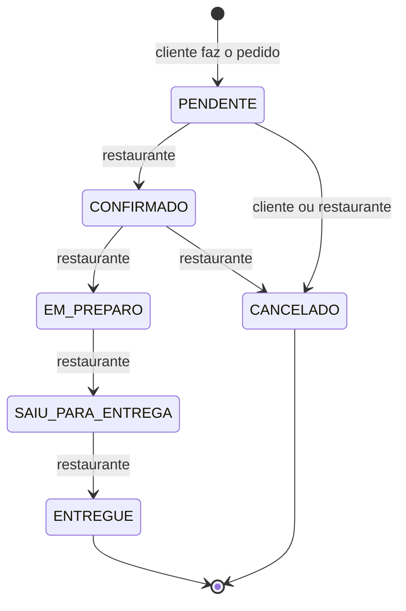

# Arquitetura da EasyFood

Documentação no modelo **C4** (Context → Container → Component → Code), mais o modelo de dados e o fluxo principal.
Os diagramas usam Mermaid e são renderizados automaticamente pelo GitHub.

## Nível 1 — Contexto

Quem usa o sistema e com o que ele conversa.

## Nível 2 — Containers

Quais aplicações e armazenamentos formam o sistema.

A interface é servida pela própria API (`express.static`), então em produção existe um único processo Node.js.

## Nível 3 — Componentes da API

Como a API está organizada por dentro: um **monólito modular**, com os mesmos papéis em cada módulo.

Responsabilidades:

| Camada | Arquivo | Faz | Não faz |
|---|---|---|---|
| Server | `server.js` | Valida config, conecta no banco, liga o HTTP, encerra com segurança | Regras, rotas |
| App | `src/app.js` | Cria e conecta as peças, registra middlewares e rotas | Acessar banco |
| Routes | `*.routes.js` | Mapeia método + caminho → controller, aplica `authenticate` | Validar, regras |
| Controller | `*.controller.js` | Lê `req`, valida com o schema, chama o service, escolhe o status HTTP | SQL, regras de negócio |
| Service | `*.service.js` | Regras de negócio e autorização (dono, cliente, transições de status) | Conhecer `req`/`res` ou SQL |
| Repository | `*.repository.*.js` | Persistência (SQL Oracle ou array em memória) | Regras de negócio |
| Database | `src/database/oracle.js` | Pool de conexões, transações, tradução de erros do Oracle | Conhecer entidades |

## Nível 4 — Código (exemplo: fazer um pedido)

## Modelo de dados (Oracle)

`ORDER_ITEMS` guarda nome e preço do item **no momento da compra**: se o restaurante mudar o preço depois, pedidos antigos não mudam.

## Ciclo de vida do pedido

As transições ficam em `src/modules/orders/order-status.js`. A atualização no banco usa `WHERE id = :id AND status = :statusAtual`: se duas pessoas tentarem mudar o mesmo pedido ao mesmo tempo, só a primeira vence e a outra recebe `409`.

## Padrões de projeto utilizados

| Padrão | Onde | Para quê |
|---|---|---|
| **Layered Architecture** | routes → controller → service → repository | Separar responsabilidades |
| **Modular Monolith** | `src/modules/*` | Separar por domínio sem distribuir |
| **Repository** | `*.repository.oracle.js` / `*.repository.memory.js` | Isolar a persistência |
| **Factory** | `src/database/repositories.js` | Escolher a implementação por configuração |
| **Dependency Injection** (manual) | funções `create...()` + `src/app.js` | Trocar dependências sem alterar quem usa |
| **Middleware / Chain of Responsibility** | `authenticate`, `errorHandler` | Etapas encadeadas na requisição |
| **State Machine** | `order-status.js` | Controlar transições válidas do pedido |
| **Unit of Work** (via transação) | `withTransaction()` em `oracle.js` | Pedido + itens gravados atomicamente |
| **Object Pool** | pool do `oracledb` | Reaproveitar conexões com o banco |
